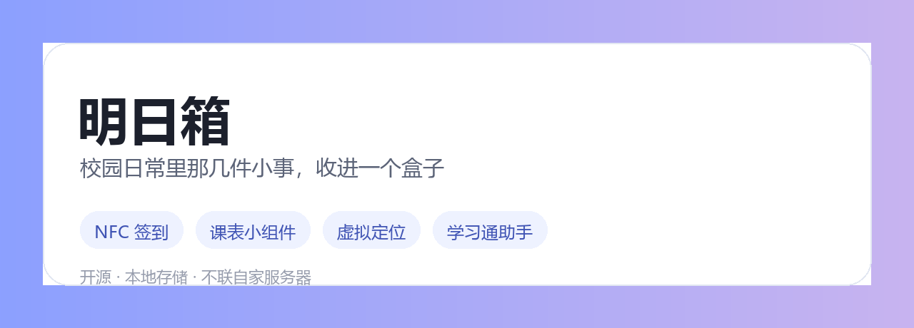
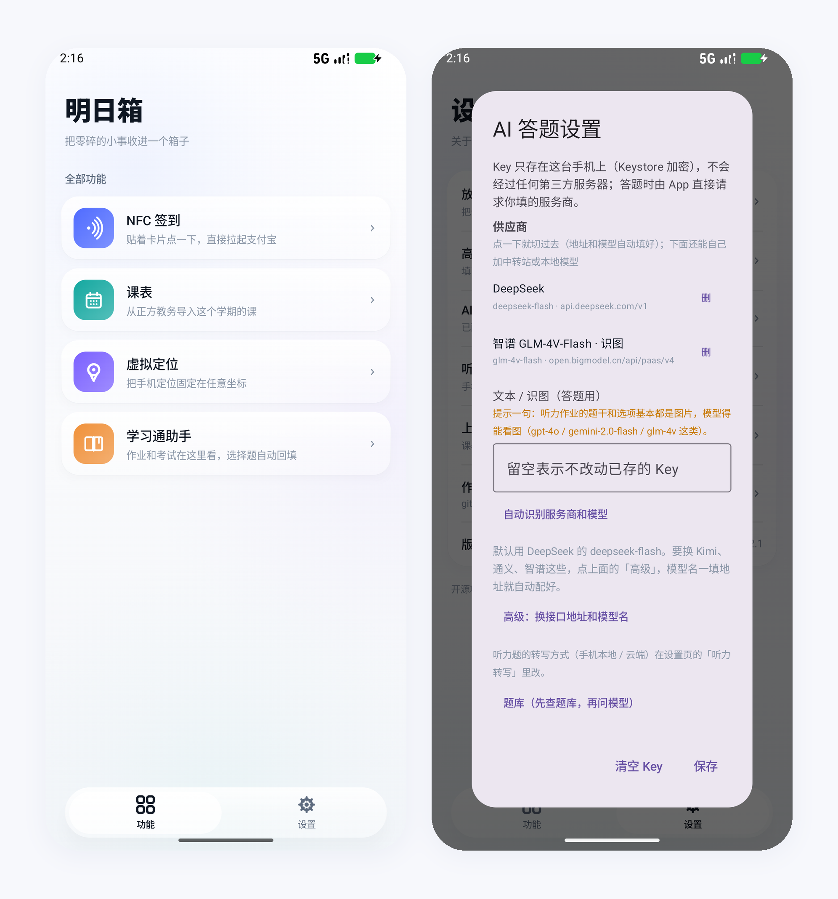

# 明日箱 / AsukaBox

把校园里常用的几件事放进一个 App：NFC 签到、课表与桌面小组件、虚拟定位、学习通作业助手。

纯 Compose 手写，Liquid Glass 外观，没引第三方 UI 库。



## 下载

都在 [Releases](https://github.com/SecondChild07/AsukaBox/releases/latest)，Android 7.0+。

| 文件 | 大小 | 说明 |
|---|---|---|
| `AsukaBox-2.1.apk` | 52 MB | 瘦包。听力第一次用时下载 228 MB 语音模型，也可以从手机文件导入 |
| `AsukaBox-2.1-full.apk` | 281 MB | 完整包。语音模型已内置，装完直接用，做听力全程不联网 |
| `sensevoice-model.zip` | 229 MB | 语音模型本体，给瘦包手动导入：设置 → 听力转写 → 从手机文件导入 |

两个 APK 签名相同，可以互相覆盖升级；和 2.0 及更早的包签名不同，先卸载旧的再装。

---

## NFC 签到

贴一下 NFC 标签，读出链接，拉起支付宝签到页。没有标签就长按「签到」手输一次，之后点按钮即可。链接用 Keystore 加密存本机。

## 课表

从正方教务（zfsoft / jwglxt）拉本学期课表，支持学期切换、单双周、当前周定位。打开 App 自动同步，失败保留旧数据。

桌面小组件默认 3×2，按卡片高度自动切两行版或单行版，尽量把当天的课都塞下。

## 虚拟定位

在开发者选项里把明日箱设为「模拟位置信息应用」，之后可把定位钉在任意坐标。地图选点、搜城市、粘贴坐标都行。

搜具体地点要在设置里填自己的高德 Key，[lbs.amap.com](https://lbs.amap.com) 免费申请，服务平台选「Web 服务」。

## 学习通助手

登录一次，之后打开就是清单，未完成 / 已完成分开列。点一条进作答页，检测到答题页会自动开填，也可以手动点「开始答题」。**只填不交**。

- 答题要一个 AI Key。设置里填进去，首行有「自动识别服务商和模型」：App 会拿 Key 去常见服务商问一遍模型列表，认出来后自动填好接口地址和模型名，优先挑能看图的。
- 开跑前会自检一次接口。模型名过期（比如 `deepseek-chat` 已下架）会自动换成服务商支持的，Key 无效则立刻停下报原因，不会先转写几分钟再失败。
- 听力题的题干和选项基本都在图片里，模型得能看图（gpt-4o / gemini-2.0-flash / glm-4v 这类）。纯文本模型不报错，但图片题只能留空。
- 听力音频默认在本机转写：sherpa-onnx + SenseVoice，中英日韩粤一份模型，音频不出手机，断网可用。首次使用下载 228 MB（校验 SHA-256），也可以从手机文件导入，或直接用自带模型的安装包。
- 想用云端转写就切到「云端接口」，填一个 whisper 兼容的地址即可。
- 转不出来就留空并在界面上说明，不猜答案。
- 扫课程走原生 HTTP，20 门课约 6 秒。会话 Cookie 用 Keystore 加密存本机。

---

## 构建

JDK 17+、Android SDK 36。

```bash
./gradlew :app:assembleDebug
```

release 约 52 MB（含 onnxruntime 原生库，arm64 + armeabi-v7a）。debug 四个架构全打进，约 132 MB，模拟器用 debug。

要让安装包自带语音模型（装完不用下载、不用拷文件），先把模型 zip 放到 `asr-assets/asr/sensevoice-model.zip`（该目录不进 git），再：

```bash
./gradlew --no-configuration-cache -PWITH_ASR=true :app:assembleRelease
```

产物约 281 MB，首次转写时自动解压到私有目录。

签名写在 `local.properties`（不进仓库），没有则用 debug 签名：

```properties
RELEASE_STORE_FILE=release.jks
RELEASE_STORE_PASSWORD=***
RELEASE_KEY_ALIAS=***
RELEASE_KEY_PASSWORD=***
```

改过 `local.properties` 或加了 `-P` 参数时记得带 `--no-configuration-cache`，否则 Gradle 复用旧配置，改动不生效。

发版：改 `versionCode` / `versionName`，提交后打 tag。

## 数据

| 内容 | 存法 |
|---|---|
| 教务账号密码、课表、签到链接、学习通 Cookie、AI Key、高德 Key | Android Keystore AES-256-GCM |
| 学期、同步时间、作业清单缓存 | 明文 SharedPreferences |

没有自家服务器，也没有埋点上报。除登录教务、拉地图瓦片、访问学习通和你填的 AI 服务商，App 不联网。

## 权限

- `NFC`：读标签
- `ACCESS_MOCK_LOCATION`：进「模拟位置信息应用」列表
- `ACCESS_FINE_LOCATION` / `ACCESS_COARSE_LOCATION`：Android 10~13 前台服务的硬性要求，App 不读你的位置
- `POST_NOTIFICATIONS`：虚拟定位的前台服务通知

## 测过的

- AI 答题只在 **DeepSeek V4.1 Flash**（模型名 `deepseek-flash`）上跑过完整流程：一份 25 空听力作业，按顺序填完、没提交。OpenAI、智谱、硅基流动、Groq 这些走同一套 OpenAI 兼容协议，没有逐家实跑，出问题请在 issue 里带上原始报错。
- 语音转写用 sherpa-onnx + SenseVoice（中英日韩粤一份模型）。英文测试音频逐字正确，中文短句正常；只在 x86_64 模拟器上验证过，arm64 真机是同一份代码编译，以你手机上的结果为准。
- NFC 签到、课表导入、虚拟定位依赖各自的外部环境（标签、教务站点、开发者选项），只做到能跑通，不保证覆盖所有学校。

## 范围

读自己的标签、导自己的课表、改自己的定位、做自己的作业。替别人签到、用虚拟定位打考勤、登录别人账号、代写作业，不在这个项目的范围内。

作业助手只填空不提交；考试场景请按学校规定来。

## License

MIT

## 致谢

地图用 [Leaflet](https://leafletjs.com) + 高德瓦片；玻璃质感参考 [Kyant0/AndroidLiquidGlass](https://github.com/Kyant0/AndroidLiquidGlass)。
