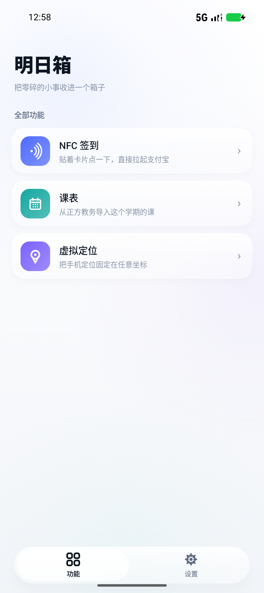
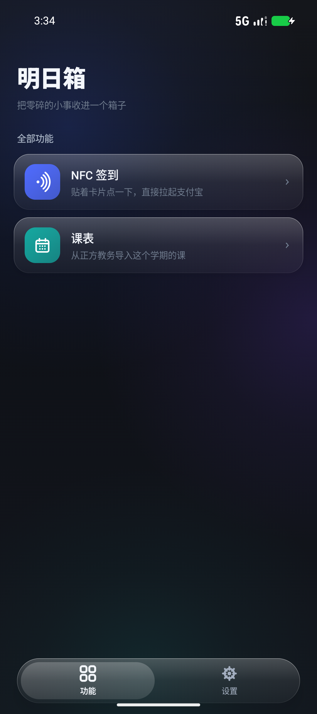
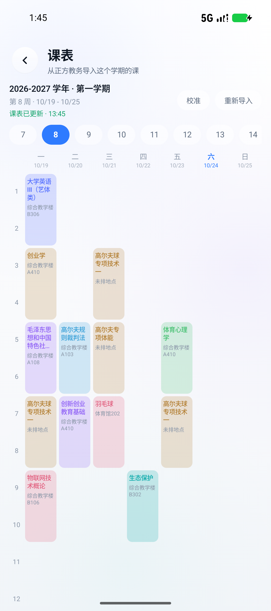
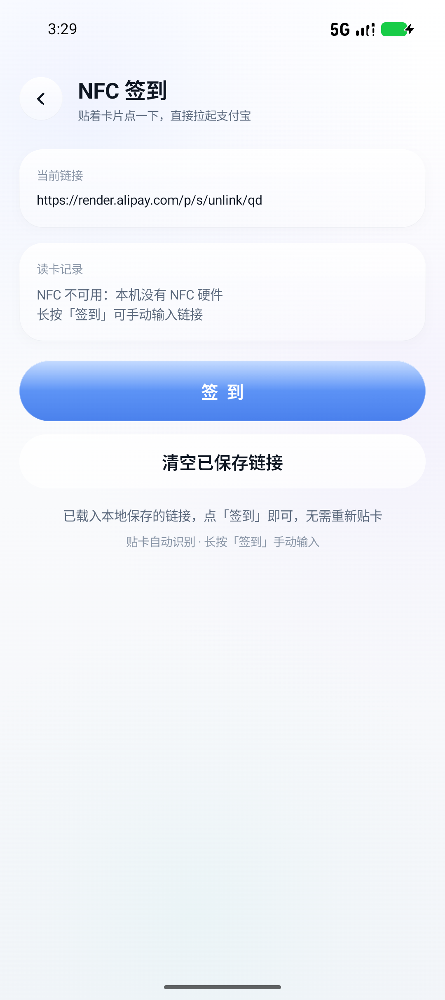
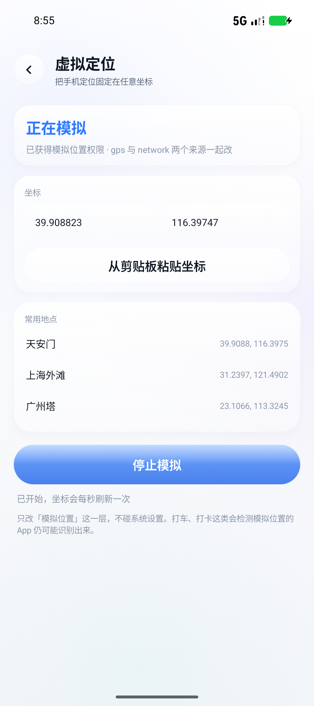

# 明日箱 · AsukaBox

<p align="center">
  
</p>

<p align="center">
  
  
  
</p>

<p align="center">
  
  
  
  
</p>

> 贴着 NFC 卡片点一下，把卡里的签到链接丢给支付宝；顺带把正方教务的课表抓下来做成一张桌面小卡片；需要的话还能把手机定位固定在任意坐标。
> 界面是纯 Compose 手写的 Liquid Glass，**没有引任何第三方 UI 库**。

**[⬇️ 下载 APK](https://github.com/SecondChild07/AsukaBox/releases/latest)** · 2.2 MB · Android 7.0+

---

## 它干什么

四个入口：NFC 签到、课表导入、虚拟定位、桌面小组件。只有课表同步和地图瓦片需要联网，其余都在本地跑。

### 1. NFC 签到

支付宝的一些 NFC 签到活动，标签里写的是一个 URL。手机系统碰到这种标签只会弹「打开链接」，而你要的是**直接进支付宝签到**。

这个功能做三件事：

1. **读卡** —— `enableReaderMode` 主动读 NFC-A/B/F/V，优先走 NDEF，读不到就退回原始页读（MifareUltralight `readPages` / NfcA `0x30`）
2. **挑链接** —— 标签里的内容经常不是一条干净的 URL：可能埋在一段 JSON 里、可能被 `\u002f` 转义过、可能是 base64。所以有一套多级正则 + 打分，从纯文本里把最像签到链接的那条挖出来
3. **唤起** —— 伪造一个 `ACTION_NDEF_DISCOVERED` Intent 直接投给支付宝（`setPackage("com.eg.android.AlipayGphone")`），失败再退回 `ACTION_VIEW`

顺带：读到的链接存本地，下次不用重新贴卡；没有 NFC 硬件也能长按「签到」手动粘贴。

<p align="center">
  
</p>

### 2. 课表导入（正方教务）

填学校教务系统的地址、学号、密码，把这一学期的课抓下来，按周显示成网格。

- 支持**正方新版教务**（`/jwglxt` 那套），登录走 RSA 加密 + 可选验证码；`/jwglxt` 前缀不存在时会自动试根路径（很多学校没这个前缀）
- 抓回来的课和账号都存在本地，用 Android Keystore 的 AES-256-GCM 加密，之后完全离线看
- 网格按周切换，单双周、跳周（`1-8,10-16周`）、连上多节都能正确显示
- 课程颜色按课名 hash 分配，同一门课前后一致

### 3. 虚拟定位

走系统的 test provider（`addTestProvider` + `setTestProviderLocation`）：在开发者选项里把明日箱选成「模拟位置信息应用」之后，就能在地图上点一个点，把定位钉在那儿。

每 100 毫秒推一次，provider 属性和 Location 字段都按真实 GPS 的规格配（高功耗 + 精确定位 + `satellites=7`），这样定位 SDK 才不会把它当成不可信的源丢掉。

不用 root，不装 Xposed。代价是：坐标必须持续灌，服务一停系统立刻回真实位置（所以用前台服务 + 常驻通知）；打车、考勤这类会查 `isFromMockProvider()` 的 App 仍可能识破；蓝牙 / WiFi 定位不走这两个 provider，改不了。



## 界面结构

- **功能页**：竖向列表，一行一个功能 —— 左侧彩色图标，右侧名称 + 一句说明，末尾箭头
- **详情页**：从列表点进去，顶栏带返回和一句功能说明
- **设置页**：作者主页 + 版本号

底部是一个玻璃胶囊，左右各占一半，切「功能 / 设置」。

导航只有两层，所以没有引 Navigation Compose —— 两个 `rememberSaveable` 变量就够了：

| 状态 | 含义 |
|---|---|
| `tabName` | 当前底部 tab |
| `detailId` | 详情页的功能 id，`null` 表示不在详情页 |

`BackHandler` 在 `detailId != null` 时接管返回键。

## 课表是怎么抓的

教务系统没有 API，只能照着网页的流程走一遍。五个请求：

| 步骤 | 请求 | 作用 |
|---|---|---|
| 1 | `GET {前缀}/xtgl/login_slogin.html` | 拿 `csrftoken`，顺便看页面里有没有验证码输入框 |
| 2 | `GET {前缀}/kaptcha?time=…` | 页面要验证码的话拉一张图（和上面同一个 cookie 会话） |
| 3 | `GET {前缀}/xtgl/login_getPublicKey.html` | 拿 RSA 公钥（`modulus` / `exponent`） |
| 4 | `POST {前缀}/xtgl/login_slogin.html` | 密码 RSA 加密后提交 |
| 5 | `POST {base}/kbcx/xskbcx_cxXsKb.html?gnmkdm=N2151` | 拿 `kbList` JSON |

**前缀不是固定的。** 大多数学校是 `/jwglxt`，也有直接把这一层去掉、登录页就在 `/xtgl/...` 的。所以 `openLoginPage()` 会挨个试 `""` 和 `"/jwglxt"`，哪个返回的 HTML 里有 `csrftoken` 就用哪个；课表接口的前缀还可能和登录不一样，`fetchTimetable()` 再试一轮。填地址时也可以直接把课表页的地址粘进去，`normalizeBase()` 会自动截到域名。

几个踩过的点（每一条都真的会让人卡半天）：

- 密码不是明文提交，前端用 jsbn 做了 RSA。这边等价实现是 `RSA/ECB/PKCS1Padding`，**密文字节再做一次 base64**（对应前端的 `hex2b64(rsaKey.encrypt(pwd))`）。直接提交十六进制串，服务端只会回「用户名或密码不正确」
- 表单要同时带 `mm` 和 `mm2` 两个同名字段，少一个也会被拒
- **单双周是段级的**：`zcd` 可能是 `1-3周,6-8周(双),9-18周` 这种混排 —— 只有 `6-8` 那一段是双周，`9-18` 是每周都有。早期版本把整串拆开后拿「有没有双字」去过滤整个集合，结果 `9-18` 整段被当成双周砍掉，表现为「第 9 周之后某门课凭空消失」。现在按逗号分段、段内单独判单双
- 周次串里也会出现 `第16周` 这种单周写法，解析时别只认 `a-b` 区间
- 验证码不能靠「kaptcha 接口能不能出图」来判断 —— 有的站接口照样出图，但登录页根本没有填验证码的地方，硬塞一个 `yzm` 上去反而会被当成错误请求。正确做法是看页面里有没有 `name="yzm"` / `id="yzm"`
- **登录成功的判断不能只看重定向后的 URL**：Android 的 `HttpURLConnection.getURL()` 跟完重定向后不一定更新成最终地址，所以还得看响应体里有没有 `initMenu` 这类登录后首页的痕迹
- 公钥字段有时是 base64、有时是十六进制文本，`decodeAny()` 两种都吃
- 有些学校页面是 GBK（响应头却写 UTF-8），按 UTF-8 读会把「用户名或密码不正确」读成一串问号，所以 `decodeText()` 见到替换字符就退回 GB18030
- 有的服务器开 gzip 却不给 `Content-Encoding`，所以读流时先嗅探 `1f 8b` 魔数
- **没引 OkHttp**：整条链路只有五个请求、一个 `JSESSIONID`，手写 `CookieJar` + `HttpURLConnection` 比拖 800KB 依赖划算

课表 JSON 里的字段对应：`kcmc` 课名、`xm` 教师、`cdmc` 地点、`xqj` 星期、`jcs` 节次、`zcd` 周次、`xqmc` 校区、`xsxx.XM` 学生姓名。

已知实测通过的部署：`/xtgl` 无前缀 + 1024 位公钥 + GBK 页面的那种。其他部署没条件挨个试，遇到不兼容的欢迎提 issue 带上错误提示原文（**请把学校域名和账号打码**）。

> 只在点「导入」时联网，抓完就断开。地址、学号、密码、课表、签到链接全部用设备绑定的 AES-256-GCM（`ks1:` 前缀）加密后落盘，`adb shell cat shared_prefs/*.xml` 看到的是一串密文。密钥在 Android Keystore 里、不可导出，所以拷走文件也解不开 —— 但 App 自己当然能还原（它要拿去登录），设备被 root 或进程被调试时密码仍然是明文。

## 周次和日期怎么对上

正方**不给开学日期**，接口里跟日期有关的字段全是服务器当天：`rqazcList` 是空数组，`sjkList` 只有两条且不含星期，`kbList` 里每条 `dateDigitSeparator` 都写着今天，课表页面源码里也搜不到「当前周 / 第几周」。所以表头的 `10/20` 这类日期只能是客户端推算的。

规则在 `data/TermCalendar.kt`：

- 起始周一是估算的 —— 秋季学期（`xqm=3`）按当年 9 月 1 日，第二学期（`12`）按次年 2 月 24 日，短学期（`16`）按次年 7 月 1 日，再对齐到周一
- 打开课表时用「今天 − 起始周一」算出当前第几周，自动跳到那一周，并且把周次条滚到能看见
- 估错了就点标题右边的**校准**，选「今天这周是第几周」，反推出真实的起始周一存下来，以后都按这个算
- 老版本存的课表没有 `startDate` 字段，读取时会自动补一个估算值再写回去，不用重新导入

今天那一列（在查看的周正好包含今天时）星期和日期都用主题色高亮。

## 加一个功能

1. 在 `ui/FunctionsScreen.kt` 的 `featureList` 里加一条 `Feature(id, name, desc, color) { 你的图标 }`
2. 在 `ui/AppNav.kt` 的 `FeatureDetail` 里给这个 `id` 接上对应的 Composable
3. 需要新图标就往 `ui/GlassIcons.kt` 里加一个 `fun DrawScope.xxxIcon(color: Color)`

宫格是按列表自动排布的，加功能不用动布局代码。

## 关于那层玻璃

不是 Material，也不是贴图。整套折射是真的：

- 背景 = 中性底色（近白 / 近黑）+ 3 颗**很淡**的径向光斑，26 秒一圈用 `sin/cos` 缓慢漂移。光斑只在玻璃边缘经过时才看得出流动，平时几乎是一块干净的底
- 玻璃面板 = 把背景那块区域 `record` 进一个 `GraphicsLayer` → `BlurEffect` 模糊 → 按圆角裁切 → 上面叠一层渐变 tint 和 1dp 描边
- 所以玻璃下面透出来的模糊色块，是**实时的背景**，换主题颜色它就跟着变
- 卡片另有一层 `Modifier.shadow`（浅色 6dp / 深色 8dp），在近白底上靠它浮起来
- 按压回弹用 spring：`dampingRatio = 0.42f` / `stiffness = 900f`

三个文件撑起整套视觉：

| 文件 | 职责 |
|---|---|
| `glass/Backdrop.kt` | 录制背景图层，`GlassRoot` 负责把 layer 塞进 `CompositionLocal` |
| `glass/LiquidGlass.kt` | 折射层 + 质感层，以及按钮/开关/输入框这些玻璃控件 |
| `glass/GlassTheme.kt` | 明暗两套调色板 |

**踩过的坑，写下来免得你也掉进去：**

被 `record {}` 录进 `GraphicsLayer` 的子树里，不能有任何组件再去 `drawLayer()` 同一个图层。否则 Skia 的渲染树会成环，`RenderNode::prepareTreeImpl` 一路递归到底，直接 SIGSEGV —— 不是 Java 异常，logcat 里只有 native 栈。

所以背景层和内容层必须是**兄弟节点**：

```kotlin
Box(Modifier.fillMaxSize()) {
    Box(Modifier.matchParentSize().drawWithContent {
        backdrop.record { this@drawWithContent.drawContent() }
        drawLayer(backdrop)          // 只画背景
    }) { AnimatedBackdrop(palette) }
    content()                        // 内容里的玻璃面板去引用 backdrop
}
```

## 构建

需要 JDK 17+ 和 Android SDK 37。Gradle 版本走 wrapper，不用单独装。

```bash
git clone https://github.com/SecondChild07/AsukaBox.git
cd AsukaBox
# local.properties 里写上 sdk.dir=/path/to/Android/Sdk
./gradlew :app:assembleDebug
```

装上之后：

```bash
adb install -r app/build/outputs/apk/debug/app-debug.apk
```

## 测试

```bash
./gradlew :app:testDebugUnitTest
```

30 个单元测试，全部对着纯函数打，不需要真机也不需要模拟器：

| 测试 | 覆盖 |
|---|---|
| `CourseWeeksTest` | `zcd` 周次串解析 —— 区间、跳周、**段级单双周**、`第16周` 这种单周写法、中文逗号分号、空串 |
| `UrlPickerTest` | 链接打分与排序、`\u002f` 转义还原、去重、短串不误判 |
| `CoordinateTest` | GCJ-02 ↔ WGS-84 双向转换、往返误差 < 1 米、境外坐标原样返回 |
| `WidgetRowsTest` | 小组件行数按高度换算，含上限 6 行与地板 1 行 |
| `LoginJudgeTest` | 登录成功判定（重定向 / 正文痕迹 / 兜底）、从 `tips`/`bg_danger`/JSON 里抠错误提示 |

单双周那条是回归测试：早期版本把「有没有双字」当成整串标志，`1-3周,6-8周(双),9-18周` 里 `9-18` 整段被砍掉，表现为「第 9 周之后某门课凭空消失」。

CI 里 `Unit tests` 是独立一步，挂了不会去构建 APK。

## 签名

发布签名不写死在代码里。两种方式提供，优先级都行：

**`local.properties`**（这个文件已经 gitignore 了）

```properties
RELEASE_STORE_FILE=release.jks
RELEASE_STORE_PASSWORD=你的口令
RELEASE_KEY_ALIAS=你的别名
RELEASE_KEY_PASSWORD=你的口令
```

**或者环境变量**：`RELEASE_STORE_FILE` / `RELEASE_STORE_PASSWORD` / `RELEASE_KEY_ALIAS` / `RELEASE_KEY_PASSWORD`

没配置也不会报错 —— release 会自动退回 debug 签名，能编译能装，但别拿去分发。

生成自己的 keystore：

```bash
keytool -genkeypair -keystore app/release.jks -alias mykey \
        -keyalg RSA -keysize 2048 -validity 10000
```

构建时 Gradle 会从 keystore 里读出证书的 SHA-256，注入成 `BuildConfig.CERT_SHA256`，运行时的签名校验拿它比对。**换签名不用改一行代码。**

## 加固

这个项目顺带把常见的 Android 加固手段串了一遍，代码都在 `security/`：

- **R8 混淆**：`-repackageclasses ''` 把所有类塞进默认包，`-overloadaggressively` 把方法重载到极致。注意 AGP 9 的 `optimization { enable = true }` **只做优化不做混淆**，`isMinifyEnabled` 才是开关，而且 `packageScope` 里必须把自己的包名写进去，否则业务类会被排除在外
- **字符串加密**：包名、检测路径、业务域名全 xor 加密，运行时才还原。这个不是为了「防住谁」，主要是让别人 `strings` 一下看不出这 App 在干什么
- **运行时四道闸**：包名校验 → 签名校验 → 调试器检测（`TracerPid` + `isDebuggerConnected`）→ 注入框架检测（`maps` 里的 frida/xposed/substrate、`/data/local/tmp/frida-server`、`Class.forName("...XposedBridge")`）
- **失败只停用、不毁数据**：检测没过时把界面换成一段说明、功能停掉，**不删课表也不杀进程**。早期版本是「清空 SharedPreferences + killProcess」，后来想明白这个取舍不对：装过 LSPosed 的机器、某些 ROM 的 maps 里带 gum 字样都会误报，让用户凭空丢掉全部数据，代价远大于它挡住的东西（代码都开源了，真想改的人早绕过去了）

**但开源之后要清楚：** 上面这些检测逻辑现在都公开了，绕过成本比闭源时低不少。真挡得住的是「改个图标重新打包发出去」这种人（签名校验一关就死），挡不住拿 Frida 专门盯你的人。要更强只能上 native 层校验或者商业壳。

坐标怎么给：点「在地图上选点」拖地图点一下（高德底图），或者手填/从剪贴板粘（会自己从一段文字里抠出「纬度, 经度」）。


地图这块有一个必须处理的坐标系问题：**高德瓦片是 GCJ-02，系统 GPS provider 要 WGS-84**，两者在北京差约 600 米。所以页面上同时显示两个坐标 —— 上面是你在地图上点的（GCJ-02），下面是真正写进系统的（转成 WGS-84 之后的）：

```kotlin
object CoordinateConverter {
    fun wgs84ToGcj02(lat: Double, lon: Double): Pair<Double, Double>
    fun gcj02ToWgs84(lat: Double, lon: Double): Pair<Double, Double>
}
```

反解没有闭式解，用的是迭代两次逼近，误差在 1 米内，够用。

地图是 Leaflet + 高德瓦片，塞在 `assets/` 里用 WebView 加载，不联网引 JS。这里踩了个很隐蔽的坑：`#map` 用 `height: 100%` 时，WebView 里量到的高度是 **0**（`map.getSize()` 返回 `376x0`），Leaflet 于是什么都不画，但 `tileload` 事件照样触发（`ok=20 err=0`），从日志看完全像是"加载成功但显示不出来"。改成 `position: fixed; top/right/bottom/left: 0` 就好了 —— fixed 定位不依赖祖先高度链。

另外改 `assets/` 里的文件后，`mergeAssets` 会报 UP-TO-DATE 把旧文件打进包里；要么删 `app/build/intermediates/assets`，要么 clean 一次。

几个必须说清楚的限制：

- **停就没了**。坐标得持续灌，服务一停系统立刻回到真实定位。所以这里用的是前台服务 + 一条常驻通知
- **不是所有 App 都吃这套**。打车、考勤这类会检查 `Location.isFromMockProvider()`，看到 `mock` 标记就可能拒单或提示。这个标记是系统打的，改不了（也不该改）
- **不能改蓝牙 / WiFi 定位**。那些靠扫描周边设备自己算，不走这两个 provider
- 需要通知权限（Android 13+）才能看到那条常驻通知，不给也能用，只是通知栏看不到状态
## 桌面小组件

设置页里有「放到桌面」，点了会走系统的 `requestPinAppWidget` 流程，确认一下就添加到桌面；也可以长按桌面 → 小组件 → 找「明日箱」。

卡片显示的是**今天**的课：头部是「第 8 周 · 10/24 周六」，标题是「今天 5 门」，下面是课程行（左边一根该课程的颜色条 + 节次 + 课程名 + 地点），点卡片任意位置打开 App。

- 当天一门课都没有时，标题隐藏、中间居中显示「今日无课」+ 第几周周几，不会自动翻到下一天 —— 周末就该是空的

几个实现上的取舍：

- 没用 Glance，走的是经典 `RemoteViews`。行数最多十来条，`RemoteViews.addView()` 现场拼就够了，省掉一整套 Glance 依赖
- 行数是**按格子高度算**的：`AppWidgetManager.OPTION_APPWIDGET_MAX_HEIGHT` 减去固定开销（内边距 + 头部 + 标题 + 脚注 `FIXED_HEIGHT_DP = 84`）除以每行 `ROW_HEIGHT_DP = 42`，所以你把卡片拉大就能多看几门，装不下的折叠成「还有 N 门」
- 刷新时机：系统按 `updatePeriodMillis`（30 分钟）拉一次；另外 App 启动、同步完成、导入课表、清空课表都会主动 `refreshAll()`，所以改完课表回桌面立刻就是新的
- 深色模式适配走 `values-night/colors.xml`，卡片底色和文字颜色各一套

**每节课的时间是自己定的**。正方教务只给「第几节」，不给几点几分（`sjkList` 里也只有服务器当天日期），所以 `data/SectionTimes.kt` 里内置了一份国内高校最常见的作息：一节 45 分钟，上午 4 节、下午 4 节、晚上 4 节（08:00 / 08:55 / 10:00 / 10:55 / 14:00 / 14:55 / 16:00 / 16:55 / 19:00 / 19:55 / 20:50 / 21:45）。你们学校不一样的话，改那两个数组就行，小组件和课程详情会一起跟着变。
## 数据怎么存的

本地落盘的东西全部加密，用的是 Android Keystore 里的一把 AES-256 密钥（`security/SecretBox.kt`）：

| 存的内容 | 存在哪 | 形态 |
| --- | --- | --- |
| 教务地址、学号、密码 | `SharedPreferences` → `jw_base` / `jw_user` / `jw_pass` | `ks1:` + base64(iv ‖ ciphertext) |
| 整份课表（含每门课的周次串） | `tt_data` | 同上 |
| 上次登录的 JSESSIONID | `jw_session` | 同上（优先复用它，省掉一次密码登录） |
| 签到链接（NFC 读到的那条） | `checkin_url` | 同上 |
| 学期、上次同步时间 | `jw_term` / `last_sync` | 明文（不含身份信息） |

密钥由 Keystore 生成在 TEE/StrongBox 里，**导不出来** —— 所以 `adb shell cat shared_prefs/xxx.xml` 看到的只有密文，把 xml 拷到别的设备上也解不开（密钥跟设备绑定，卸载重装即失效）。

两个细节：

- `SecretBox.seal()` 走 `AES/GCM/NoPadding`，每次随机 12 字节 IV 一起写进去；Keystore 不可用时退回旧的 xor 混淆格式（`old:` 前缀），保证 App 不会因为拿不到密钥就起不来
- 升级路径做了兼容：老版本存的是明文 / 只有 xor 混淆的值，读取时认得出来，`TimetableStore` 的构造里还会把它们原地重新加密一遍（`upgradePlaintext()`），所以从旧版升上来不会丢账号，也不用重新登录

## 每次打开自动更新

冷启动时 `MainActivity` 的 `LaunchedEffect` 会调一次 `TimetableSync.refresh()`：

- 有账号 → 后台登进正方重新拉一遍课表，成功就覆盖缓存，课表页因为是 `collectAsState()` 所以自己就变了，不用手动刷新
- 没有账号 / 需要验证码 / 网络不通 → 安静地留着旧数据，只有「需要验证码」和「真失败」才弹一条 Toast 说明原因（静默路径没法帮用户填验证码，那种情况得去课表页点「重新导入」）
- 整个过程中 `Dispatchers.IO`，并且在飞的时候有 `running` 标志防重入，不会因为反复切前后台打一串请求
- 同步结果会记在 `TimetableStore` 的 `syncOkFlow` 里，课表页在「第 N 周 · 日期」下面显示一行：
  - 绿色 **「课表已更新 · xx:xx」** —— 这次拉到了新数据，时间是成功那一刻
  - 橙色 **「未更新成功 · 点「重新导入」重试」** —— 网络不通 / 系统没响应 / 要验证码（静默路径填不了）
  - 没配过账号时不显示这行；手动导入成功也记一次「已更新」

**不会每次都登录**：先试上次留下的 `JSESSIONID`，能拉到课表就不碰密码；失效了才正常登录一次，登录成功后再把它存回去。再加上 30 分钟内不重复同步 —— 转屏、切深色、反复开关 App 都不会在网页端把你踢下线。

## 隐私

- 除了导入课表时和你学校的教务系统通信，不联网，没有统计，没有日志上传
- **明文的教务入口不拦，但会提醒**：正方大量部署在 `http://` 上，硬禁等于把一半学校挡在门外。所以导入时检测到你填的是 `http://`，界面上会有一行黄字说明代价（密码先过 RSA，但学号、课表、cookie 在链路上是明文）。学校有 https 入口就用 https
- 读到的链接、账号、密码、课表都只存在 App 私有目录里，且都是密文（见上面「数据怎么存的」）
- 权限一共这五个，都不是「悄悄翻你东西」：`NFC`（读卡）、`ACCESS_MOCK_LOCATION`（进开发者选项的模拟位置列表）、`ACCESS_FINE_LOCATION` + `ACCESS_COARSE_LOCATION`（Android 10~13 上 location 类型前台服务的硬性要求，App 自己不读定位）、`POST_NOTIFICATIONS`（模拟定位时那条常驻通知）

## 边界

这个工具本身是中性的，但有三件事性质不同，分开说：

- **读自己的 NFC 标签、导入自己的课表** —— 这就是它的设计用途，随便用
- **替别人刷签到** —— 属于欺诈。别做，做了也别说是这软件教的
- **虚拟定位去打卡 / 应付考勤** —— 这是考勤作弊，涉及学籍或劳动合同，后果和上面两件不是一个量级。功能给了，用不用、用到哪儿，是你自己的判断
- **自动登录教务系统** —— 多数学校的规章明确禁止第三方程序代登录，已有账号被封的先例。导入用的是你自己的账号密码，只在本机跑，但风险仍在

一句话：工具不替你做决定。

## License

[MIT](LICENSE)

## 致谢

玻璃效果是照着 [Kyant0/AndroidLiquidGlass](https://github.com/Kyant0/AndroidLiquidGlass) 的思路自己实现的 —— 那个项目用 Compose Multiplatform 做了一套 Backdrop + 模糊管线，很值得一看。
